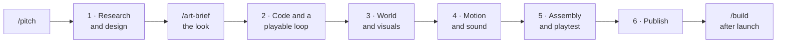

<div align="center">

# roblox-final

**A Roblox game studio for [Claude Code](https://claude.com/claude-code).**<br>
From a scored idea to a published place, with every step proven on disk before Studio sees it.

[](https://github.com/boomypig/roblox-final/actions/workflows/ci.yml)


[Quick start](#quick-start) · [How a game gets built](#how-a-game-gets-built) · [Requirements](#requirements) · [Layout](#layout) · [Checks](#checks) · [Workflow](docs/workflow.md)

</div>

---

## What it is

`roblox-final` is a set of skills, agents, research and tools that Claude Code loads to make
Roblox games. It covers the whole job: market research, pitching, design, Luau code, maps, UI,
3D models, textures, animation, VFX, sound, assembly in Studio, playtesting and publishing.

It holds no game code. Each game is its own repo next to this folder and loads the toolkit with
`claude --add-dir ../roblox-final`.

<table>
<tr>
<td width="50%" valign="top">

### Proven, not assumed
Every stage ends in a gate a script can check: `rojo build`, `lune` tests, Selene, StyLua, a
map reachability prover, UI and wiring checks. A new game is green on all four code gates
before a line of game code exists.

</td>
<td width="50%" valign="top">

### Researched design
A design library of 31 genres, 21 mechanic patterns and 10 fundamentals, plus a Roblox charts
tracker, feeds `/pitch`, which writes five scored ideas measured against your own goals.

</td>
</tr>
<tr>
<td width="50%" valign="top">

### One section per session
A game is built in six sections. Each one ends with a written `HANDOFF.md`, so you can clear
the chat and the next session resumes exactly where the last one stopped.

</td>
<td width="50%" valign="top">

### Gets better with use
A Stop hook in every game records gate failures, stalls and missed handoffs. When you run
`/toolkit-retro`, each lesson becomes a tested edit to the skill that owns it.

</td>
</tr>
</table>

| | |
|---|---|
| **15 skills** | `create-roblox-game` is the front door; one skill per craft (code, map, UI, 3D, textures, animation, VFX, SFX) |
| **10 agents** | a spec writer, a map builder, a reviewer, a market scout and six asset workers that run in parallel |
| **62 research files** | genres, mechanic patterns and fundamentals, each with dated sources |

> [!NOTE]
> The design library describes how other Roblox games are designed: their loops, pacing,
> monetization and what makes them stick. It never copies their assets, names or content, and
> nothing built with this toolkit should either.

## Quick start

```bash
git clone https://github.com/boomypig/roblox-final.git ~/roblox-final
cd ~/roblox-final
claude                                  # then type: /roblox-skills-setup
```

`/roblox-skills-setup` checks your machine, lists anything missing, and writes each skill's
personal `LOCAL.md` (your folders and tool paths; gitignored). Skill docs give script paths as
`~/roblox-final/...`, so cloning there saves adjusting them.

Then make a game:

```bash
mkdir -p private && cp goals.template.md private/goals.md   # optional: your goals and constraints
claude                                  # /pitch            -> five scored ideas in private/pitches/
python3 tools/new_game.py "My Game"     # -> ~/my-game, next to the toolkit, green on all gates
cd ~/my-game && rokit install && wally install
claude --add-dir ../roblox-final        # "complete the research and plan stage"
```

**Already have a game?** Adopt it instead of starting over. This shows what the script found
(services, remotes, config, pure rules) and changes nothing:

```bash
python3 ~/roblox-final/.claude/skills/create-roblox-game/scripts/adopt.py --dir <game>
```

Add `--write` to add the layout map, the build contract and the starter files. Your code is
never reformatted or moved.

## How a game gets built



You approve each section, clear the chat, and the next session picks up from the game's
`HANDOFF.md`. The full path, with what each step reads, writes and is gated by, is in
[docs/workflow.md](docs/workflow.md).

| Step | What you say or run | What ends it |
|---|---|---|
| Choose | `/pitch [constraints]` | five scored pitches; you pick one |
| 1 Research and design | "complete the research and plan stage" | `design/game.json` passes `validate.py` |
| The look | `/art-brief art`, `map <name>`, `ui` | you set each brief to `Status: approved` |
| 2 Code and a playable loop | "complete the code stage" | four code gates green; the loop is played on grey parts |
| 3 World and visuals | "complete the art stage" | proven map layout, meshes, UI on disk |
| 4 Motion and sound | "complete the sound stage" | animation, VFX and SFX verified |
| 5 Assembly and playtest | "complete the playtest stage" | wiring gate, two-player playtest, review against the quality bar |
| 6 Publish | "complete the publish stage" | published, live-server check |
| After launch | spec → `/build <spec>` → reviewer | four code gates green, acceptance criteria met |

A Stop hook in every game won't let a session end at a boundary (a closed section, a finished
map pass, a passing `/build`) until `HANDOFF.md` is written. Inside a section it stays silent.

## Requirements

| Need | For | Notes |
|---|---|---|
| Claude Code | everything | terminal or desktop app |
| Python 3.11+ | every script | standard library only, except the trends tracker (`requests`, `PyYAML`) |
| [Rokit](https://github.com/rojo-rbx/rokit) or Aftman | code | installs the pinned Rojo, Wally, Lune, Selene and StyLua for each game |
| Roblox Studio with its built-in MCP server | assembly, maps, playtest | one Studio connection at a time |
| Blender 4.x | 3D models, animation | optional |
| A Hugging Face token (`HF_TOKEN`) | generated meshes | optional; Kaggle is never used |
| A Roblox Open Cloud key (`ROBLOX_API_KEY`) | permanent asset uploads, publish | optional; assets still work inside a Studio session without it |

The tested setup is Windows with WSL (Ubuntu): Studio runs on Windows and every tool runs in
WSL. Keys are read from environment variables and never written to a file. The smoke test finds
rokit's copies of the gate tools; to use others, set `ROBLOX_TOOLS_BIN` to a folder holding them.

## Layout

| Path | What |
|---|---|
| [`.claude/skills/`](.claude/skills) | The 15 skills, each with its rules, references, scripts, traps and gate |
| [`.claude/agents/`](.claude/agents) | The 10 agents; each names the skill that owns its knowledge |
| [`vault/`](vault) | The design library. Start at [`vault/INDEX.md`](vault/INDEX.md) |
| [`tools/`](tools) | `new_game.py`, `smoke.py`, `toolkit_lint.py`, `migrate_game.py`, `build_cards.py`, vault checks, and the trends tracker in `tools/trends/` |
| [`starter/`](starter) | The docs every new game repo starts with |
| [`docs/`](docs) | The workflow and operating policy, the shape of a skill, decisions, moved paths |
| [`tests/`](tests) | The toolkit's own tests |
| `private/` | **Yours, never in git:** goals, pitches, trend data, case studies, notes. Everything works without it |

<details>
<summary><b>All 15 skills</b></summary>

| Skill | What it does |
|---|---|
| `create-roblox-game` | The front door: runs a game section by section, owns research, design and assembly |
| `roblox-build-orchestrator` | Times and logs a build, fans asset work out to the workers |
| `pitch` | Five scored pitches from your goals, the vault and the trends report |
| `art-brief` | Turns reference images into an art, map or UI brief with real values |
| `build` | Implements an approved mechanic spec |
| `roblox-code` | The Luau rules, the project scaffold and the four code gates |
| `roblox-map` | Maps from a JSON spec, with a prover for what a player can reach |
| `roblox-ui` | HUDs, shops and menus from a JSON spec, with a mockup |
| `roblox-3d-model` | Text to a verified, Roblox-legal mesh |
| `roblox-texture-gen` | Generated textures applied through Studio |
| `roblox-animation` | R15 and R6 animation authored headlessly in Blender |
| `roblox-vfx` | Effects judged frame by frame, exported as a Studio kit |
| `roblox-sfx` | Sound found by asset id and checked in Studio |
| `roblox-skills-setup` | First-time machine setup |
| `toolkit-retro` | Turns lessons from your games into tested toolkit edits, only when you ask |

</details>

## Checks

```bash
python3 -m unittest discover -s tests -v                  # toolkit tests
python3 tools/vault_lint.py                               # design library rules
python3 tools/build_cards.py --check                      # agent cards are current
python3 tools/toolkit_lint.py                             # duplicated rules, dead paths, untested scripts, private data
python3 tools/smoke.py                                    # a new game, every gate, every command, the hooks, adoption
cd tools/trends && python3 -m unittest discover -s tests  # tracker tests
```

GitHub Actions runs all of these on every push, and also installs Wally and runs the smoke
test with `--wally`.

## Notices

- The fonts in `.claude/skills/roblox-ui/references/fonts` are Fredoka, under the SIL Open
  Font License 1.1.
- Third-party tools and models the skills call (Blender, Rojo, Hugging Face models, Roblox
  services) have their own terms; `roblox-3d-model/references/licences.md` lists the model
  licences.
- The full list is in [NOTICE.md](NOTICE.md). Changes are in [CHANGELOG.md](CHANGELOG.md), and
  how to contribute is in [CONTRIBUTING.md](CONTRIBUTING.md).
